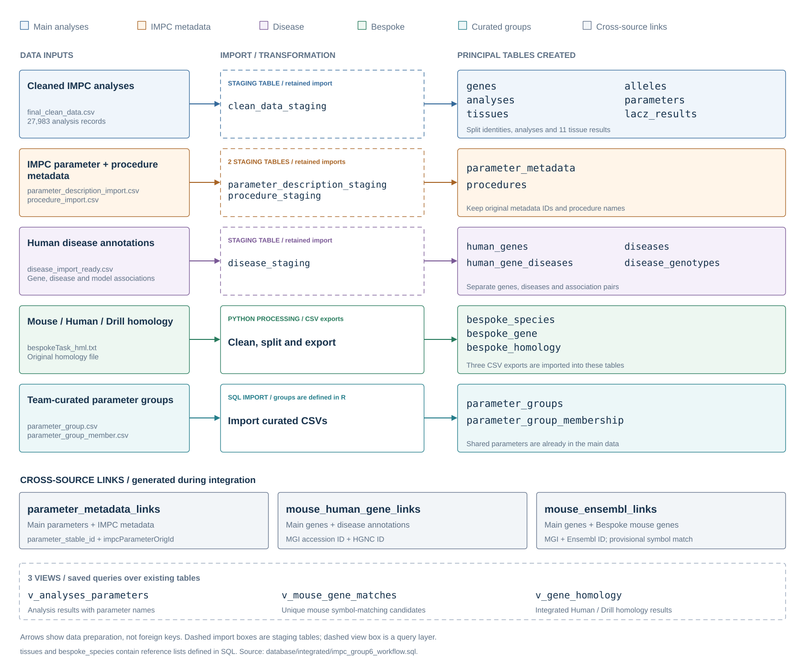
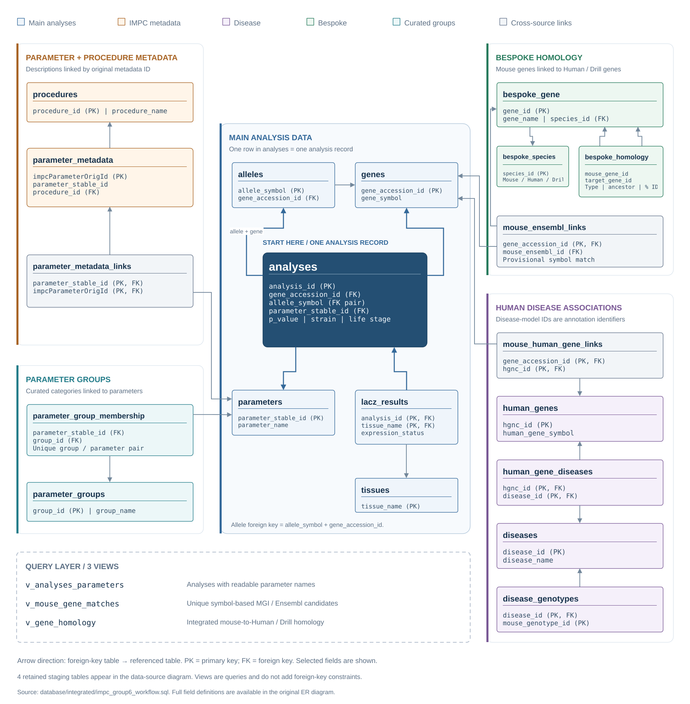

# IMPC Group 6

Group coursework for KCL 7BBG1003 Data Cleaning and Data Management.

## Folders

- `cleaning/` — Data cleaning scripts
- `bespoke/` — Homology task
- `data/` — Data information and processed outputs
- `database/` — SQL scripts and database backups
- `shiny/` — R Shiny dashboard
- `docs/` — Notes and diagrams

## Processed data

- `data/processed/clean_group6_data/final_clean_data.csv` — Cleaned main IMPC data.
- `data/processed/parameter_group/` — Parameter groups and membership tables.
- `data/processed/bespoke/` — Cleaned homology data and CSV tables for database import.

## Using the project

The integrated database combines the main data, parameter groups,
procedure metadata, disease information and bespoke homology data.

- Follow the [database instructions](database/integrated/README.md)
  to restore the complete database or rebuild it from CSV files.
- See the [Bespoke instructions](bespoke/README.md)
  for homology cleaning rules, exports and the standalone database.
- The database backup is in `database/backups/`.
- ER diagrams are in `docs/data_relationships/`.

Shiny setup instructions will be added when the app is available
in this repository.

## Database overview

The database contains 24 tables: 20 principal tables and four staging
tables. Three views provide combined query results. Colours identify
the data sources; grey tables connect records from different sources.

### Data sources and transformations

[Editable draw.io source](docs/data_relationships/IMPC_data_lineage.drawio)

### Table relationships

The diagram shows the 20 principal tables and all 21 foreign keys.
Start with `analyses` in the centre, then follow its links to the gene,
allele, parameter and tissue results before exploring the surrounding data.
Arrows point from a foreign-key table to its referenced table.

[Editable draw.io source](docs/data_relationships/IMPC_database_structure.drawio)
| [Full ER diagram](docs/data_relationships/IMPC_ER_diagram_final.png)
